# Práctica 5. Colaboración en GitHub y Resolución de Conflictos Remotos

## 3. Procedimiento de la Práctica

### Fase 1: Preparación del Repositorio y Subida Inicial

1. Abre tu terminal y crea una nueva carpeta para esta práctica:

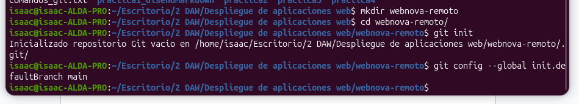

2. Crea un archivo llamado **equipo.md** con el siguiente contenido:

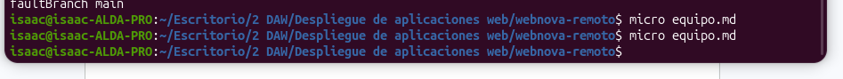
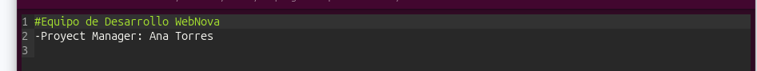

3. Haz tu primer commit local:

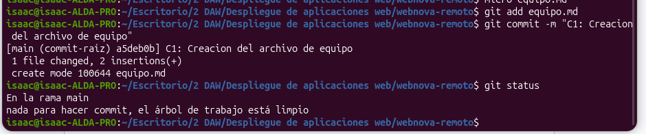

4. **Ve a tu cuenta de GitHub** y crea un nuevo repositorio vacío llamado **webnova-remoto** (sin README ni .gitignore).

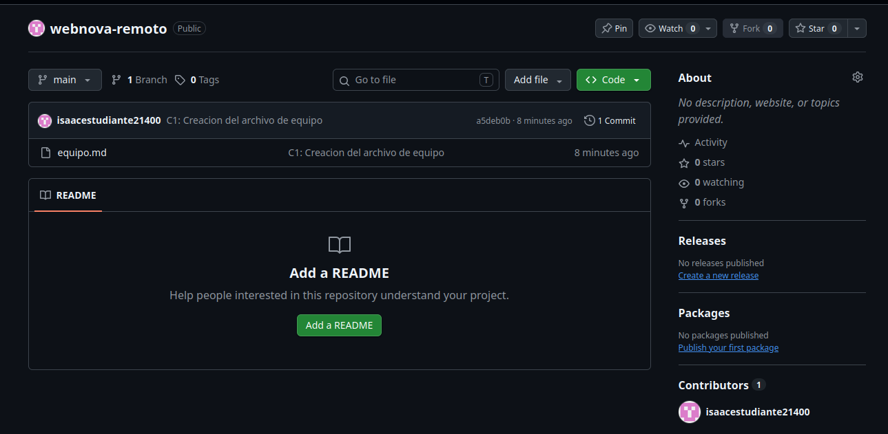

5. Copia la URL SSH del repositorio y vincúlalo a tu terminal:

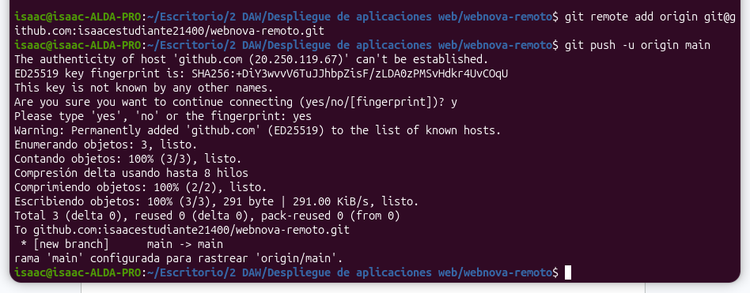

### Fase 2: El Compañero Virtual (Simulación en la Nube)

Vamos a simular que un compañero de trabajo actualiza el repositorio en **GitHub** mientras tú estás haciendo otras cosas.

1. Sin cerrar la terminal, ve al navegador web, entra en tu repositorio de **GitHub** y abre el archivo **equipo.md**.

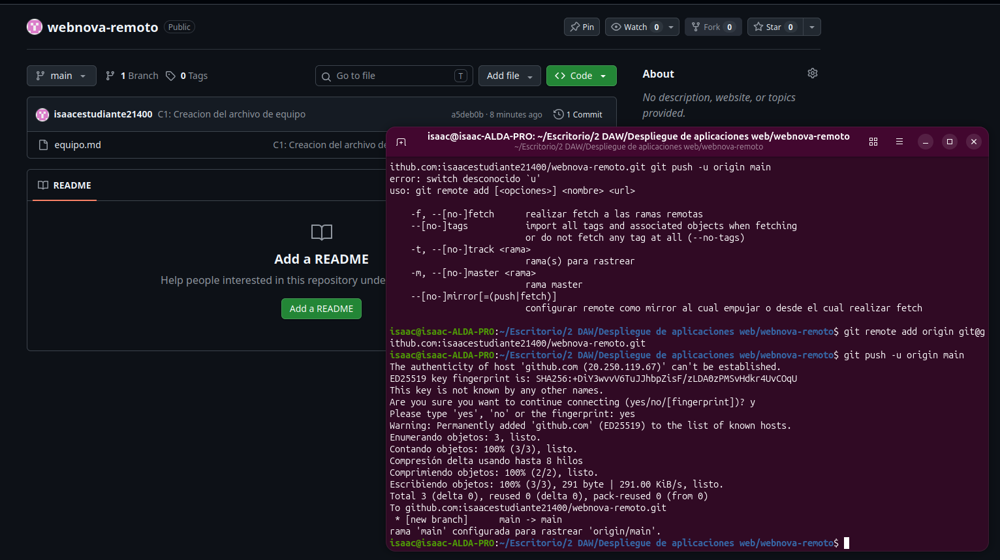

2. Haz clic en el icono del **lápiz** para editarlo directamente en la web.
3. Añade una nueva línea al final del archivo simulando el trabajo de tu compañero:

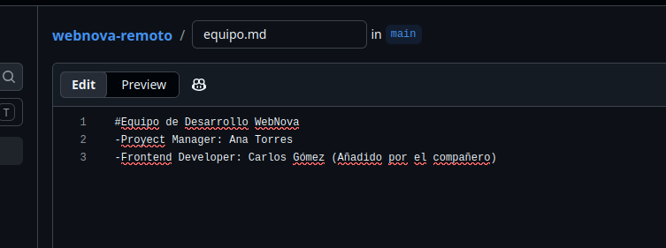

4. Haz clic en el botón verde **Commit changes...**, ponle el mensaje "C2: Añadido Frontend Developer" y confirma. *¡El repositorio remoto acaba de actualizarse!*

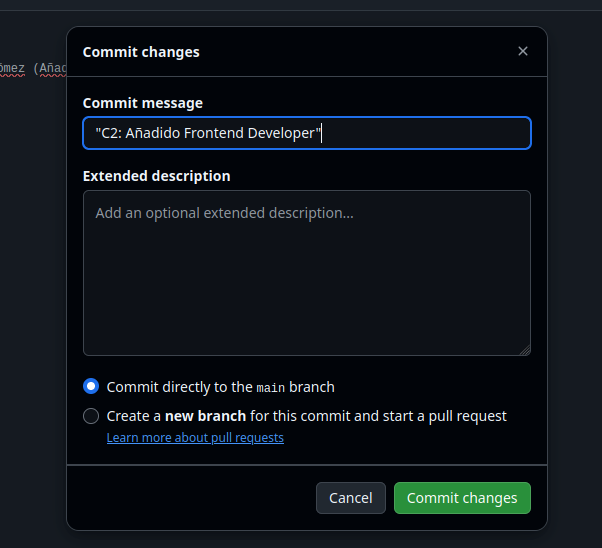

### Fase 3: Tu Trabajo Local (El Choque de Realidad)

1. Vuelve a tu terminal (que ahora mismo no sabe que la nube ha cambiado). Abre el archivo **equipo.md** en tu editor local y añade tu propio cargo en la misma línea donde supuestamente lo hizo tu compañero:

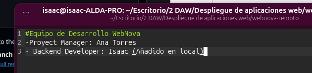

2. Haz un commit de tu trabajo en la terminal:

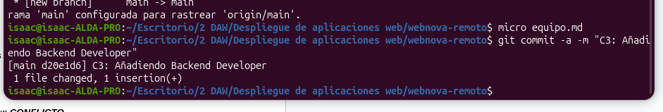

3. **El Choque:** Intenta subir tu código a GitHub:

4. **Tarea 1:** Git te bloqueará con un mensaje de error rojo. Lee atentamente la salida de la terminal. ¿Qué palabra clave usa Git para denegar la subida? ¿Qué te sugiere hacer en las líneas de **hint**:?

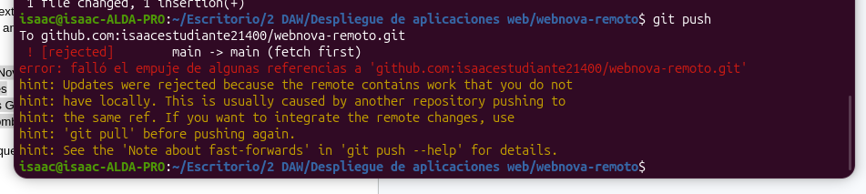

La palabra clave sería rejected. Lo rechaza porque el repositorio remoto en github tiene commits que no tengo en local.

hint: Updates were rejected because the remote contains work that you do not have locally. This is usually caused by another repository pushing to the same ref. If you want to integrate the remote changes, use 'git pull' before pushing again. See the 'Note about fast-forwards' in 'git push --help' for details.

Me está diciendo básicamente lo que acabo de explicar arriba, y que use git pull antes de pushear otra vez.

### Fase 4: El Rescate y la Resolución

1. Para solucionar el problema, debes descargar el código de tu "compañero" y poner tus cambios por encima. Ejecuta:

2. Git detendrá el proceso indicando un **CONFLICTO**.

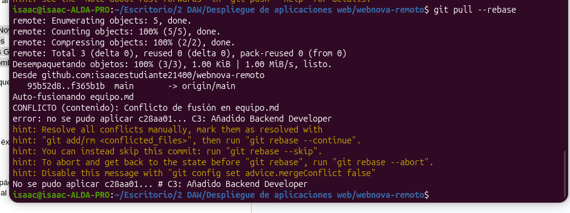

4. Abre **equipo.md** en tu editor de texto. Verás las marcas de conflicto (**<<<<<<< HEAD**).

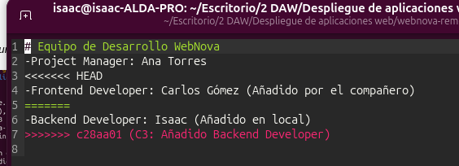

4. Borra las marcas de Git y fusiona ambas ideas para que el archivo final quede con los tres miembros del equipo:

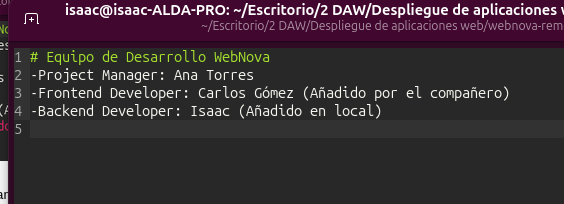

5. Guarda el archivo, indícale a Git que lo has resuelto y continúa el proceso: 6. Bash

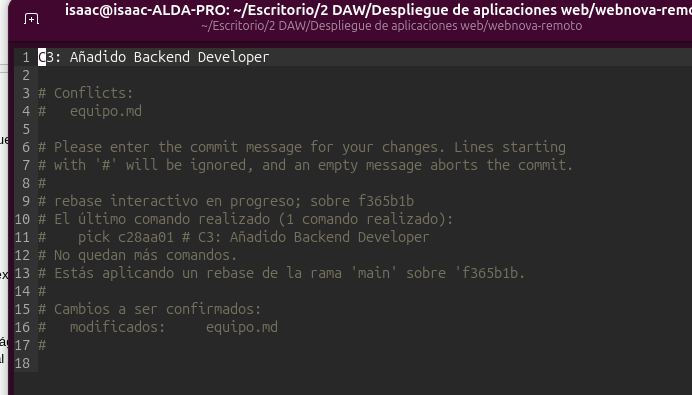

7. Una vez finalizado el rescate con éxito, sube el código definitivo a GitHub:

8. **Tarea 2:** Ve a GitHub, recarga la página y comprueba que el archivo muestra a los tres miembros del equipo y que el historial de *commits* está limpio.

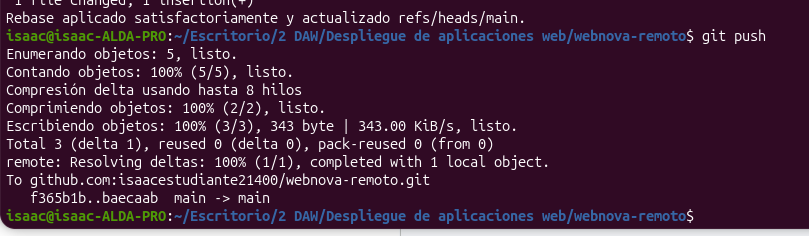

**Pregunta de reflexión:** Explica con tus palabras por qué Git bloqueó tu subida en la Fase 3 y qué ventaja tiene usar **git pull --rebase** en lugar de un simple **git pull** en estos casos.

Lo bloquea porque el repositorio remoto en github tiene commits que no tengo en local.

Si tengo en local algo distinto que en github, hay que juntar los cambios antes de subirlo. Con pull pillas los cambios de github y los traes al local para juntarlos con un commit extra. Con rebase git pilla el cambio del local, lo aparta, trae el de github, lo pone y luego el tuyo después, sin commits extras. Además el historial queda más limpio.
